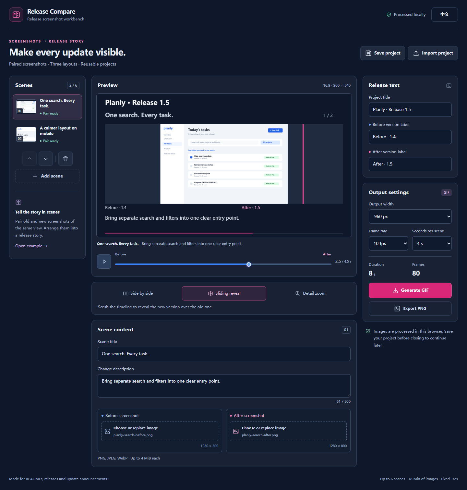

# Release Compare

### Before-and-after release GIFs from paired screenshots

**Show what changed in your next release. Add old and new screenshots, choose a comparison template, and export a GIF for your README or release notes. Save the project to reuse your scenes and settings next time.**

English | [中文](README_ZH.md)

[Quick start](#quick-start) · [Templates](#templates) · [Usage](#usage) · [Output and limits](#output-and-limits)



*Actual workbench with the fictional Planly example.*


*Focus template generated by the application from the paired search screenshots.*

## Quick start

Requires Node.js 24 or newer.

```sh
git clone https://github.com/cloudwallker/release-compare.git
cd release-compare
npm ci
npm run dev
```

Open the local URL printed by Vite. The sample is ready to preview and export. Choose **English** in the top bar to switch the default Chinese interface.

For a static build:

```sh
npm run build
npm run preview
```

Serve the contents of `dist/` with a static HTTP server. The application and its encoder are bundled; image processing and exports run in your browser.

## Templates

| Template | Useful for |
| --- | --- |
| Side by side | Showing both complete interfaces, with the active side highlighted |
| Wipe | Revealing a new interface over the old screenshot |
| Focus | Comparing the same normalized region at a larger size |

Preview and export use the same Canvas renderer and template logic. GIF export follows a fixed frame plan; the selected scene can be freely scrubbed in the preview. Screenshots keep their aspect ratio and are centered within the viewport. Version names, scene titles and change captions appear in the output.

## Usage

1. Set the project title and old/new version names.
2. Replace each scene's before and after screenshot, or add a scene. Choose static PNG, JPEG or WebP images.
3. Name the scene and describe its change. Move scenes up or down to set the sequence.
4. Choose a template. For Focus, adjust the X, Y, width and height sliders to choose a shared normalized region.
5. Scrub the timeline or play the preview. Set output width, frame rate and seconds per scene.
6. Generate the GIF and download it. The progress indicator shows encoded frames; cancellation returns you to editing.

**Save project** downloads a versioned JSON file containing screenshots, text and settings. **Import project** restores it. **Export PNG** downloads the currently selected preview frame. Your current project stays in browser memory. Download its JSON file to continue after a page refresh.

Changing content or settings clears the previous GIF download. Export uses a fixed project snapshot, with editing paused while it encodes. A failed import preserves the current project.

The included Planly screens are fictional fixtures drawn by this project, useful for trying the complete workflow.

## Output and limits

| Setting | Supported values |
| --- | --- |
| Output | GIF animation, PNG frame, JSON project |
| Canvas | 16:9; width 480, 960 or 1280 pixels |
| Frame rate | 5, 10 or 15 fps |
| Duration | 2, 3, 4 or 6 seconds per scene |
| Scenes | Up to 6 complete screenshot pairs |
| Frame budget | Up to 360 frames per GIF |
| GIF size | Up to 64 MiB; lower width, duration or fps to reduce it |
| Images | Up to 4 MiB each, 8 million pixels, longest side 4096 pixels |
| Project images | Up to 18 MiB of original image bytes in total |
| JSON import | Up to 32 MiB of UTF-8 text |

GIF uses a 256-color palette per frame. Choose a wider output for small interface text; gradients and photographic screenshots reflect color quantization. Long text wraps where space permits and ends with an ellipsis when clipped. GIF delays use cumulative centisecond rounding to preserve total duration, including 15 fps exports.

Use a current Chromium browser with Canvas and Web Workers. Development verification uses Chromium-based Edge on Windows and Playwright Chromium in CI. Rendering can vary with browser image decoding and installed fonts; repeatability is checked within the same browser environment.

## Development

```sh
npm test
npm run typecheck
npm run build
npx playwright install chromium
npm run test:e2e
```

The browser tests exercise project editing, imports, cancellation and actual GIF decoding. `src/model.ts` defines the project format and frame plan; `src/render.ts` draws both previews and exported frames; `src/gif.worker.ts` encodes frames with [gifenc](https://github.com/mattdesl/gifenc).

## Project context

This project explores repeatable release comparisons inspired by the release-video workflow of [brag](https://github.com/latent-spaces/brag). [demotale](https://github.com/pesuto-dev/demotale) and [DemoWeaver](https://github.com/mebularts/DemoWeaver) are related tools for recording running applications. Release Compare starts from screenshots you already have and provides a focused comparison workbench. The implementation and example artwork are created for this project.

Contributions can include reproducible rendering cases, template improvements and import/export fixes. Use fictional or cleared sample screenshots when sharing a case.

## License

[MIT](LICENSE) · Copyright 2026 cloudwallker. Dependencies retain their respective licenses.
