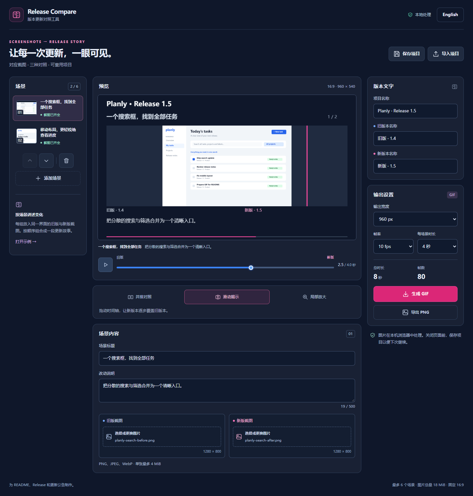
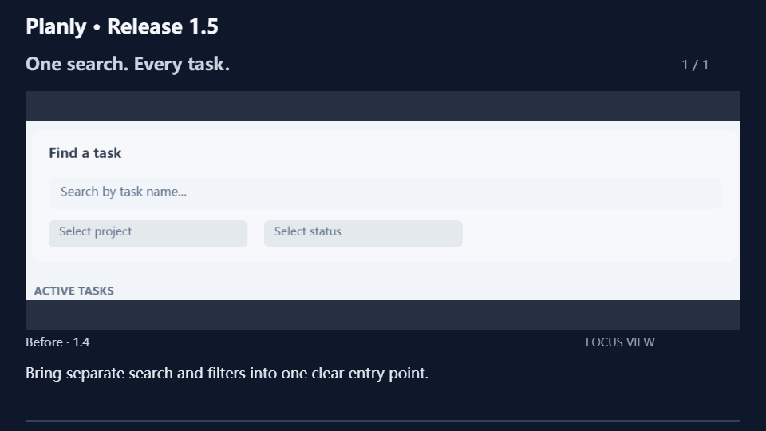

# Release Compare

### 用对应截图生成版本更新对照 GIF

**让下一次版本更新看得见。添加新旧截图，选择对照模板，导出用于 README 或更新说明的 GIF。保存项目文件，下次发布时继续使用同一组场景和设置。**

[English](README.md) | 中文

[快速开始](#快速开始) · [三种模板](#三种模板) · [使用方法](#使用方法) · [输出与容量](#输出与容量)



*实际工作台截图，内容为虚构的 Planly 演示应用。*



*应用根据对应的搜索界面截图生成的局部放大成片。*

## 快速开始

需要 Node.js 24 或更高版本。

```sh
git clone https://github.com/cloudwallker/release-compare.git
cd release-compare
npm ci
npm run dev
```

打开 Vite 输出的本地地址。内置示例可直接预览和导出；顶部语言按钮可切换中英文。

构建静态版本：

```sh
npm run build
npm run preview
```

将 `dist/` 内容放在静态 HTTP 服务器上运行。应用与编码器随构建打包，图片处理和导出在本机浏览器完成。

## 三种模板

| 模板 | 适用画面 |
| --- | --- |
| 并排对照 | 同时展示两个完整界面，用高亮引导查看旧版与新版 |
| 滑动揭示 | 从旧截图逐步揭示新版界面 |
| 局部放大 | 放大两个截图中相同的归一化区域，比较细节 |

预览和导出共用 Canvas 渲染器与模板逻辑。GIF 按固定帧计划导出，预览可自由拖动当前场景的时间轴。截图按原始比例居中显示；成片包含版本名、场景标题和改动说明。

## 使用方法

1. 设置项目名称、旧版本名称和新版本名称。
2. 替换各场景的两张截图，或新增场景。支持静态 PNG、JPEG 和 WebP。
3. 填写场景标题与改动说明，通过上移、下移安排顺序。
4. 选择模板。局部放大使用 X、Y、宽度、高度四个滑块确定共同区域。
5. 拖动时间轴或播放预览，选择输出宽度、帧率和每场景时长。
6. 生成并下载 GIF。进度显示已编码帧数；取消后可继续编辑。

**保存项目**会下载包含截图、文字与设置的版本化 JSON 文件，**导入项目**可恢复内容。**导出 PNG**保存当前预览画面。刷新页面后，通过保存的项目文件继续工作；应用在下载前把内容保留在浏览器内存中。

修改内容或设置会清除旧 GIF 的下载入口。编码使用固定项目快照，编码期间暂停编辑。导入失败时保留当前项目。

内置 Planly 截图由本项目绘制，是用于完整试用流程的虚构界面。

## 输出与容量

| 设置 | 支持值 |
| --- | --- |
| 输出 | GIF 动画、PNG 单帧、JSON 项目 |
| 画布 | 16:9；宽度 480、960、1280 像素 |
| 帧率 | 5、10、15 fps |
| 时长 | 每场景 2、3、4、6 秒 |
| 场景数 | 最多 6 组完整截图 |
| 帧数 | 每个 GIF 最多 360 帧 |
| GIF 大小 | 最大 64 MiB；可减小宽度、时长或帧率来降低体积 |
| 单图 | 最大 4 MiB、800 万像素、最长边 4096 像素 |
| 项目图片 | 原始图片字节总量最大 18 MiB |
| JSON 导入 | 最大 32 MiB UTF-8 文本 |

GIF 每帧使用 256 色调色板。界面文字较小时可选择更宽的输出；渐变和照片会体现色彩量化效果。长文字按空间换行，截断时显示省略号。帧延迟按累计时间取整到厘秒，保留包括 15 fps 在内的准确总时长。

使用支持 Canvas 和 Web Worker 的新版 Chromium 浏览器。开发验证使用 Windows 上的 Edge，CI 使用 Playwright Chromium。浏览器图片解码与本机字体会影响渲染；同一浏览器环境下验证重复导出的结果一致。

## 开发

```sh
npm test
npm run typecheck
npm run build
npx playwright install chromium
npm run test:e2e
```

浏览器测试覆盖项目编辑、导入、取消和实际 GIF 解码。`src/model.ts` 定义项目格式与帧计划，`src/render.ts` 同时绘制预览和导出帧，`src/gif.worker.ts` 使用 [gifenc](https://github.com/mattdesl/gifenc) 编码。

## 项目来源与贡献

项目借鉴 [brag](https://github.com/latent-spaces/brag) 的发布视频工作流，探索可重复生成的版本对照。[demotale](https://github.com/pesuto-dev/demotale) 与 [DemoWeaver](https://github.com/mebularts/DemoWeaver) 提供运行中应用的录制能力。Release Compare 从已有截图出发，提供集中的对照制作界面。实现代码与演示图由本项目制作。

欢迎提交可复现的渲染案例、模板改进和导入导出修复。共享案例请使用虚构或已清理的截图。

## 许可证

[MIT](LICENSE) · Copyright 2026 cloudwallker。各依赖保留自己的许可证。
